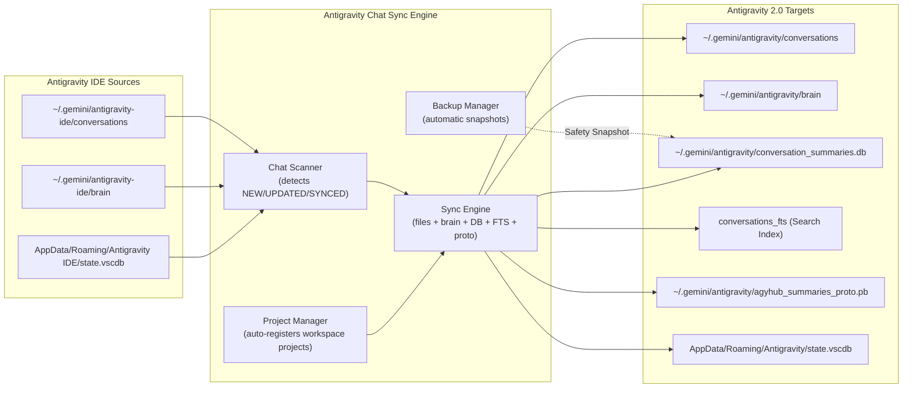

# 🚀 Antigravity Chat Sync (IDE → Antigravity 2.0)

A high-performance desktop application and CLI tool that seamlessly bridges conversations, transcripts, brain artifacts, and project workspaces from **Antigravity IDE** (VS Code based) into **Antigravity 2.0** (Electron desktop application).

---

## ✨ Features

- **⚡ 1-Click Sync**: "Sync All Pending" instantly copies all new and updated IDE chats into Antigravity 2.0 with a single click.
- **🎯 Selective Sync**: Select specific chats or sync conversations belonging to a particular project workspace.
- **🔄 Live Auto-Sync (Watcher)**: Optional background watcher monitors IDE chats and automatically propagates new prompts and conversations into Antigravity 2.0.
- **📁 Automatic Project Registration**: Automatically registers IDE workspace folders into Antigravity 2.0's Project Registry (`config/projects/<id>.json`, `projects.json`, and `state.vscdb`) so projects and their chats appear cleanly grouped under their project folders.
- **🧠 Full Brain & Artifact Migration**: Copies transcripts (`transcript.jsonl`), scratch scripts, uploaded files, and generated artifacts so the conversation history in 2.0 has the exact same context.
- **🔍 Full-Text Search Indexing**: Updates Antigravity 2.0's `conversations_fts` search index so that searching for keywords in 2.0 immediately finds imported chats.
- **🧬 Bit-for-Bit Protobuf Sync**: Reads and merges trajectory summaries into `agyhub_summaries_proto.pb` and `antigravityUnifiedStateSync.trajectorySummaries` in `state.vscdb`.
- **🛡️ Automatic Safety Snapshots**: Takes timestamped backups of `conversation_summaries.db` and `state.vscdb` before any sync operation. Includes a 1-click **Rollback & Restore** manager.
- **🎨 Modern Dark UI with 60 FPS Acceleration**: Beautiful, responsive CustomTkinter dark theme with debounced search, pagination, and a 2ms native Table View.

---

## 📦 Installation & Requirements

### Prerequisites
- Python 3.10 or higher
- Windows 10/11 (with Antigravity IDE and Antigravity 2.0 installed)

### Setup
1. Clone the repository:
   ```bash
   git clone https://github.com/your-username/antigravity-chat-sync.git
   cd antigravity-chat-sync
   ```

2. Install dependencies:
   ```bash
   pip install -r requirements.txt
   ```

3. (Optional) Create a Desktop Shortcut:
   ```bash
   python install_desktop_shortcut.py
   ```

---

## 🖥️ How to Launch the Application

### 1. From Desktop Shortcut
If you ran `python install_desktop_shortcut.py`, double-click the **Antigravity Chat Sync** icon on your Desktop.

### 2. From File Explorer / Batch Launcher
Double-click `AntigravityChatSync.bat` inside the project folder.

### 3. From Terminal / PowerShell
```powershell
python run_gui.py
```

---

## 💻 Command Line Interface (CLI)

The tool also includes a full headless CLI for automated scripting or terminal use:

```powershell
# 1. Scan and inspect all IDE conversations & their sync status
python run_cli.py scan

# 2. Filter scan by status or project
python run_cli.py scan --status NEW
python run_cli.py scan --project "MyProject"

# 3. Sync all pending conversations
python run_cli.py sync

# 4. Sync a specific conversation by ID
python run_cli.py sync --cid <conversation-id>

# 5. Sync all conversations for a specific project
python run_cli.py sync --project "MyProject"

# 6. Run background auto-sync watcher
python run_cli.py watch --interval 5.0

# 7. List all database backups
python run_cli.py backups

# 8. Restore from a backup snapshot
python run_cli.py backups --restore "<path-to-backup-file>"
```

---

## 🏗️ Architecture & Mechanics



---

## 🛡️ Privacy & Security

This project contains **zero user data, conversation databases, or personal paths**:
- Default configuration paths dynamically resolve relative to each user's home directory (`~/.gemini` and `%APPDATA%`).
- All conversation content and local workspaces remain entirely on your local machine.
- No telemetry, analytics, or external network requests are made.

---

## 📄 License

MIT License. See [LICENSE](LICENSE) for details.
